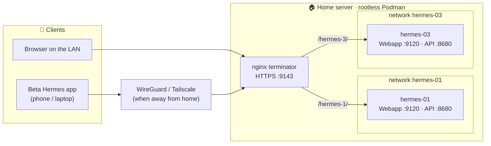

## Dear Lord Why?

I run more than one [Hermes](https://github.com/NousResearch/hermes-agent) agent at home, each in its own rootless Podman container with its own memory, tools and voice. Each one used to have its own dashboard on its own port, with its own certificate story. Hermes now serves a full **Webapp** from the gateway itself (sessions, terminal, files, Git review), and the beta Hermes app can connect to a remote gateway. I wanted both to work against every agent, through one HTTPS port, without exposing anything to the internet.

The result is a small nginx "terminator": one port, one certificate, `/hermes-1/`, `/hermes-3/`, and so on, each forwarded to its own isolated container.

AI has assisted the detailed write-up (and the migration). The packaged config is public at [5L-Labs/hermes-agents-infra](https://github.com/5L-Labs/hermes-agents-infra).

<!-- truncate -->

## What does it look like?



- **Locally**, a browser opens `https://<home-server>:9143/` and lands on `/hermes-1/`. Every agent lives under `/hermes-N/`.
- **Away from home**, the beta Hermes app (and the browser) come in over WireGuard or Tailscale, so the same URL works and nothing is published to the internet.

## Why nginx, if Hermes already serves the Webapp?

Hermes does the hard part: the Webapp, its `/api`, the chat WebSocket and authentication. The wrapper only adds what a single gateway can't do on its own:

1. **One origin for many agents.** `/hermes-N/` for N from 1 to 99 maps to the container `hermes-0N` (or `hermes-NN`) by Podman DNS at request time, so a new agent needs no new port.
2. **Prefix handling.** nginx strips `/hermes-N`, and passes the original `Host` (including the port), `X-Forwarded-Proto` and `X-Forwarded-Prefix`, so the Webapp builds its links and sign-in redirects under the right mount.
3. **Streaming and WebSockets.** Upgrade headers are forwarded, buffering is off, and timeouts are long enough for an agent that is thinking.
4. **TLS in one place.** One certificate, one port, HTTP/2, and an HTTP→HTTPS redirect.
5. **A separate API mount.** `/hermes-N/external-api/` goes to the agent's separate API server on 8680, and never collides with the Webapp's own `/api`.

The heart of it is one `location`:

```nginx
location ~ ^/hermes-(?<hermes_instance>[1-9][0-9]?)(?<hermes_external_api>/external-api(?=/|$))?(?<hermes_path>/.*)?$ {
    set $hermes_prefix /hermes-$hermes_instance$hermes_external_api;
    set $hermes_target $hermes_container:$hermes_port;
    rewrite ^/hermes-[1-9][0-9]?(?:/external-api)?(/.*)$ $1 break;

    # A variable upstream uses Podman DNS at request time, not startup.
    proxy_pass http://$hermes_target;
    proxy_set_header Host $http_host;
    proxy_set_header X-Forwarded-Proto $scheme;
    proxy_set_header X-Forwarded-Prefix $hermes_prefix;
    proxy_set_header Upgrade $http_upgrade;
    proxy_set_header Connection $hermes_connection;
    proxy_buffering off;
    proxy_read_timeout 600s;
}
```

A `map` picks the port per agent: 9120 for the Webapp, 8680 for the external API. Agents that haven't moved yet stay on the old dashboard port, which made the migration one agent at a time.

## Container orchestration

Everything is rootless Podman with [Quadlet](https://docs.podman.io/en/latest/markdown/podman-systemd.unit.5.html) units, the same pattern as my [Home Assistant Bluetooth post](/self-hosted-iot/rootless-podman-bluetooth):

- **One network per agent.** `hermes-01` and `hermes-03` sit on separate Podman networks and can't see each other.
- **Only nginx joins every network**, with IPv4 and IPv6 forwarding turned off inside its container, so it can't route one agent's traffic to another. To be honest about the boundary: a compromised nginx could still reach every agent it fronts. Authentication stays in Hermes.
- **nginx is locked down**: read-only root filesystem, tmpfs for run/cache/logs, `NoNewPrivileges`, a PID limit, and read-only mounts for config and certificates. It is the only thing published for the browser UI.
- **Each agent trusts exactly one proxy address**: its `dashboard.trusted_proxies` lists nginx's address on that agent's network, and nothing wider.

On the Hermes side, each agent only needs a few lines merged into its profile:

```yaml
webapp:
  enabled: true
  host: 0.0.0.0
  port: 9120
  public_url: https://hermes.example.com:9143/hermes-1
dashboard:
  trusted_proxies:
    - 10.203.1.10   # nginx's address on this agent's network
```

## Getting in from outside: WireGuard or Tailscale

The Hermes docs are blunt about this, and they're right: a signed-in Webapp user can run commands as the account running Hermes. Username and password sign-in is for a trusted LAN or VPN only; anything internet-facing needs OAuth/OIDC.

So I don't forward the port. Away from home, the phone joins the home network over [WireGuard](/self-hosted-iot/wireguard-silent-failures) (Tailscale works the same way), and the beta Hermes app points at `https://<home-server>:9143/hermes-1` as a **Remote gateway**. HTTPS matters even on the VPN: browsers switch off the microphone, clipboard and notifications on plain HTTP to anything but localhost.

[FIXME: 2–3 sentences on the actual beta app experience — which app/platform, whether the prefixed URL worked first time, and how sign-in felt.]

## What was hard about it?

[FIXME: pick the real story. Candidates from the migration notes:
- The old dashboard bundle hard-coded a root-relative lazy-load path, so it needed a build-specific `sub_filter` patch to work under `/hermes-N/`. The Webapp doesn't; the patch is now scoped to the legacy port only.
- Restarting an agent mid-task interrupts it. Hermes supports a restart-when-idle signal (`SIGUSR1`), which waited for the active turn to finish before restarting.
- Proxy trust is pinned to nginx's address on each network, which has to be revisited if nginx is recreated.]

## Did it work?

Yes. Both agents serve the Webapp under their own prefix: login, reload, assets and the live chat WebSocket all work, and each agent rejects the other's sign-in cookie. One agent was moved first as a canary, then the second. The old dashboards are still running behind the scenes for rollback; retiring them is the next cleanup.

If you want to try it, the sanitized config, Quadlet units and a test suite (real nginx against stub backends: routing, WebSocket upgrade, streaming) are in [5L-Labs/hermes-agents-infra](https://github.com/5L-Labs/hermes-agents-infra).
